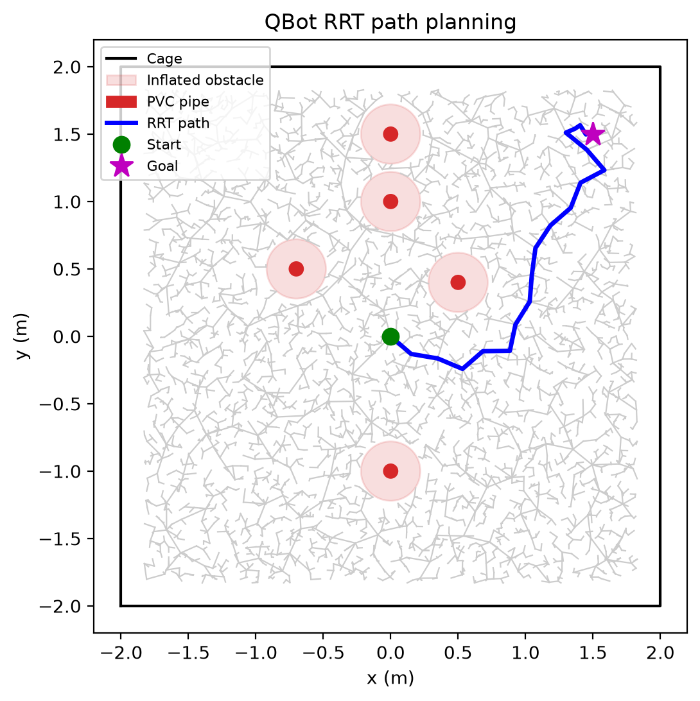

# QBot RRT Path Planning in Quanser QLabs

This project plans a collision-free route for a Quanser QBot Platform through
a cage containing circular PVC-pipe obstacles. The route is planned with the
RRT implementation from the Lab 2 notebook, then can be followed by the
virtual QBot in Quanser Interactive Labs (QLabs).

## Demo

[Watch the QLabs run](media/exhibition_vid.mp4) · [View the planned route](media/rrt_path.png)

The QLabs video is configured for Git LFS because it is larger than GitHub's
100 MB limit for regular Git files. GitHub may show it as a file link rather
than an inline player.



## What it does

- Samples configurations uniformly and grows an RRT using the Lab 2 algorithm.
- Inflates each pipe by the QBot radius so collision checks can treat the QBot
  as a point.
- Shrinks the cage bounds by the QBot radius to keep the planned center inside
  the walls.
- Checks sampled vertices and connecting edges against the inflated obstacles.
- Optionally connects to QLabs and drives the virtual QBot along the planned
  route.

## Map and result

The current map is defined in [config.py](config.py):

| Setting | Value |
|---|---:|
| Cage bounds | `[-2, 2] × [-2, 2] m` |
| Start | `(0, 0) m` |
| Goal | `(1.5, 1.5) m` |
| PVC pipe radius | `0.05 m` |
| QBot radius used for inflation | `0.17 m` |
| Inflated obstacle radius | `0.22 m` |
| RRT waypoints in the saved run | `21` |
| Saved route length | `3.25 m` |

The plotted gray lines show the explored tree; the blue line shows the selected
route. The route image is generated by the planner and is not a recording of
the QBot's actual motion.

## Project files

| File | Purpose |
|---|---|
| `config.py` | Cage, obstacle, start, and goal settings |
| `rrt.py` | Lab 2 RRT functions and the project planner wrapper |
| `environment.py` | Spawns PVC pipes in QLabs |
| `main.py` | Plans, plots, and optionally drives the virtual QBot |
| `qlabs_rrt_run.py` | Self-contained RRT and QLabs runner |
| `media/rrt_path.png` | Rendered RRT tree and planned route |
| `media/exhibition_vid.mp4` | QLabs demo recording |

## Requirements and setup

Planner-only mode requires Python, NumPy, and Matplotlib:

```powershell
python -m pip install -r requirements.txt
```

QLabs mode additionally requires Quanser's `pal`, `qvl`, and `qlabs_setup`
modules, the Quanser Python API, QLabs, and the QBot Platform virtual RT
models. The Quanser modules and RT models are supplied by the Quanser
installation/course environment; they are not installed by `requirements.txt`.
Run the QLabs script from an environment where those imports and models are
available.

## Run

From the project directory:

```powershell
python main.py --no-sim
python main.py
```

`--no-sim` runs the planner and saves `media/rrt_path.png` without connecting
to QLabs. The default command starts the QLabs setup, spawns the obstacles,
plans the route, and follows it with the virtual QBot. Ensure QLabs and the
virtual QBot Platform driver are available at `localhost`; do not run another
QBot controller at the same time. Press `Ctrl+C` to interrupt the drive.

The standalone script can be copied beside `qlabs_setup.py` in a Quanser
project folder and run with:

```powershell
python qlabs_rrt_run.py
```

It includes the Lab 2 planner and map directly, so it does not depend on this
project's `rrt.py` or `config.py`.

## GitHub: tracking the demo video

The repository includes `.gitattributes` to store `media/*.mp4` with Git LFS.
Before adding the video to a Git commit, install/enable Git LFS and make sure
the video is tracked as an LFS object:

```powershell
git lfs install
git lfs track "media/*.mp4"
git check-attr filter -- media/exhibition_vid.mp4
```

The last command should report `filter: lfs`. Add the `.gitattributes` file
before adding the MP4 so Git stores the video as an LFS object. If a large MP4
was already committed as a regular Git file, tracking it now does not remove
that copy from earlier commits. Confirm the LFS object is present before
pushing:

```powershell
git add .gitattributes README.md config.py environment.py main.py qlabs_rrt_run.py requirements.txt rrt.py media/rrt_path.png media/exhibition_vid.mp4
git lfs ls-files
git status
```

## Notes

The RRT is randomized, so other seeds or map changes can produce a different
tree and route. The waypoint follower estimates position from commands and
gyroscope readings, so drift is possible. Validate the map and QLabs behavior
before attempting any physical-robot run.

Lab-manual content from Quanser is not redistributed here; the RRT code is my
own implementation.
